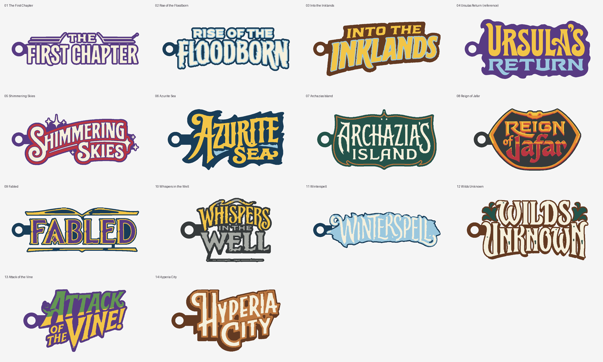

# Shared attachment diameters

All thirteen other current sets now use Set 04’s 5.5 mm attachment bore and nominal 10.5 mm outer diameter (2.5 mm rim). Their original 2 mm backing and loop thickness is retained. Set 04’s printed reference project is unchanged.

All thirteen revisions pass Bambu Studio slicing with every intended filament and no plate warnings. Artwork, colour meshes, non-bore backing contours, placement and project settings are preserved. Set 05 retains its continuous red panel and reinforced stars. The rebuilt backings have no degenerate triangles; Set 14’s four pre-existing degenerate Caramel faces remain in its unchanged colour mesh. Physical printing and ring fit have not been tested.

| Set | Current project |
| --- | --- |
| 01 The First Chapter | [Set_01_The_First_Chapter_v04.3mf](../../sets/Set_01_The_First_Chapter/v04/Set_01_The_First_Chapter_v04.3mf) |
| 02 Rise of the Floodborn | [Set_02_Rise_of_the_Floodborn_v04.3mf](../../sets/Set_02_Rise_of_the_Floodborn/v04/Set_02_Rise_of_the_Floodborn_v04.3mf) |
| 03 Into the Inklands | [Set_03_Into_the_Inklands_v04.3mf](../../sets/Set_03_Into_the_Inklands/v04/Set_03_Into_the_Inklands_v04.3mf) |
| 04 Ursulas Return | [Set_04_Ursulas_Return_v05_printed.3mf](../../sets/Set_04_Ursulas_Return/v05_printed/Set_04_Ursulas_Return_v05_printed.3mf) |
| 05 Shimmering Skies | [Set_05_Shimmering_Skies_v06.3mf](../../sets/Set_05_Shimmering_Skies/v06/Set_05_Shimmering_Skies_v06.3mf) |
| 06 Azurite Sea | [Set_06_Azurite_Sea_v04.3mf](../../sets/Set_06_Azurite_Sea/v04/Set_06_Azurite_Sea_v04.3mf) |
| 07 Archazias Island | [Set_07_Archazias_Island_v04.3mf](../../sets/Set_07_Archazias_Island/v04/Set_07_Archazias_Island_v04.3mf) |
| 08 Reign of Jafar | [Set_08_Reign_of_Jafar_v04.3mf](../../sets/Set_08_Reign_of_Jafar/v04/Set_08_Reign_of_Jafar_v04.3mf) |
| 09 Fabled | [Set_09_Fabled_v04.3mf](../../sets/Set_09_Fabled/v04/Set_09_Fabled_v04.3mf) |
| 10 Whispers in the Well | [Set_10_Whispers_in_the_Well_v04.3mf](../../sets/Set_10_Whispers_in_the_Well/v04/Set_10_Whispers_in_the_Well_v04.3mf) |
| 11 Winterspell | [Set_11_Winterspell_v04.3mf](../../sets/Set_11_Winterspell/v04/Set_11_Winterspell_v04.3mf) |
| 12 Wilds Unknown | [Set_12_Wilds_Unknown_v04.3mf](../../sets/Set_12_Wilds_Unknown/v04/Set_12_Wilds_Unknown_v04.3mf) |
| 13 Attack of the Vine | [Set_13_Attack_of_the_Vine_v04.3mf](../../sets/Set_13_Attack_of_the_Vine/v04/Set_13_Attack_of_the_Vine_v04.3mf) |
| 14 Hyperia City | [Set_14_Hyperia_City_v04.3mf](../../sets/Set_14_Hyperia_City/v04/Set_14_Hyperia_City_v04.3mf) |

[Manifest.json](Manifest.json) records source and output hashes, geometry checks and slice results. Per-set validation reports and slicer evidence are stored alongside each revision and under `validation/`.

Reproduce with `python3 tools/standardize_loop_diameters.py` from the repository root, using Python with NumPy and Pillow and local Bambu Studio.
