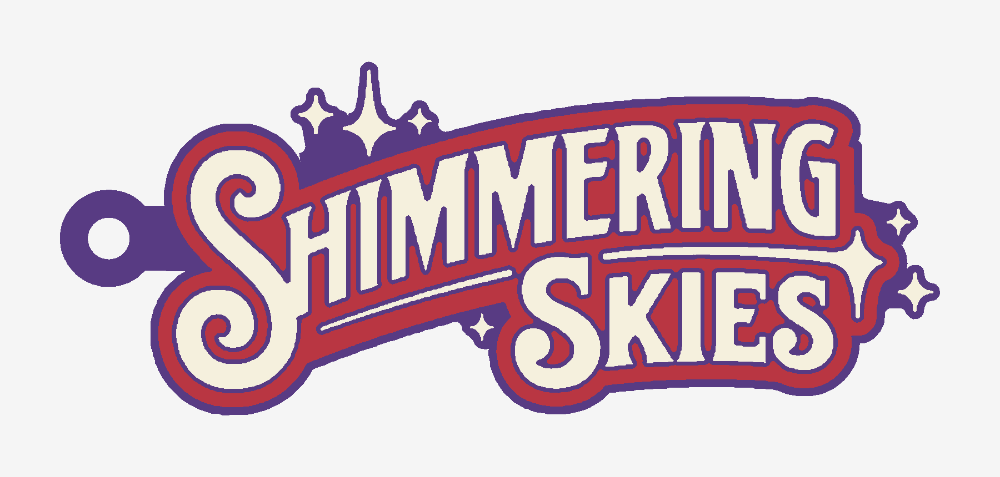

# Shimmering Skies v05

Open [Set_05_Shimmering_Skies_v05.3mf](Set_05_Shimmering_Skies_v05.3mf)
as a **project** in Bambu Studio and assign the three colours to your spools.

The six projecting stars now have broad, rounded purple supports into the main
body. Each support reaches the star's centre and widens into the wordmark,
replacing the narrow pointed joins in v04. The new necks are nominally 3.4 mm
wide, with 4.5 mm feet and 0.7 mm rounding at the roots. Each support uses the
full 2 mm backing thickness. Small voids at the star connections are filled.

All seven star-to-body connections, including the large sparkle integrated into
the right-hand flourish, pass a geometric check for a continuous 3 mm material
corridor. The check erodes the actual backing footprint by 1.5 mm and verifies
that each star centre remains connected to the main body at 0.05 mm resolution.
The six projecting stars did not pass this check in v04. This verifies geometry;
physical strength and resistance to breakage have not been tested.

The red panel and ivory artwork are exactly the same meshes as v04, preserving
the previous colour fix and all star details. The native keyring bore contour is
retained. Plate placement, filament colours and embedded A1 / 0.4 mm nozzle /
0.20 mm process settings are unchanged. The purple backing is remeshed at
0.025 mm resolution; dimensions are approximately 94.95 × 38.20 × 3 mm.
Previous project versions are preserved.



[The sliced preview](Set_05_Shimmering_Skies_v05_sliced_preview.png) is rendered
from actual Bambu toolpaths. Bambu Studio 02.08.02.61 slices the project
successfully, uses all three colours and reports no plate warnings. The three
meshes are closed manifold solids with positive volumes and no degenerate
triangles. Footprint checks find no unsupported artwork or red/ivory overlap.

Reports: [Geometry_v05.json](Geometry_v05.json),
[Validation_v05.json](Validation_v05.json). Slicer logs, results and G-code are
in [validation/Set_05_Shimmering_Skies/v05](../../../validation/Set_05_Shimmering_Skies/v05/).
The relocated Flatpak CLI uses embedded settings despite missing `/app` preset
resource messages. No physical print was performed.

Reproduce from the repository root with NumPy and Pillow:

```sh
python3 tools/rebuild_set05.py --version v05
python3 tools/validate_set05.py --version v05
```

Only a 3MF project is generated. Original artwork and trademarks belong to
Disney/Ravensburger.
