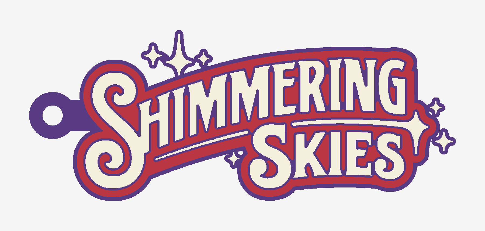

# Shimmering Skies v1.3

Open [Set_05_Shimmering_Skies_v1.3.3mf](Set_05_Shimmering_Skies_v1.3.3mf)
as a **project** in Bambu Studio, assign the three project colours to your spools,
and slice.

This revision fixes the abrupt purple/red division in **v1.2**. The source
artwork's gradient had been thresholded into a red region starting halfway
through the title. Red now forms a uniform inset across the complete wordmark,
including the large S and both words. Purple supplies the outer border and
consistent 0.45 mm outlines around the ivory artwork. The detached sparkles
and attachment remain purple with ivory details.

Only the red mesh is replaced. The backing, keyring and ivory mesh are exactly
the same as v1.2, as are the plate placement and embedded A1 / 0.4 mm nozzle /
0.20 mm process and filament settings. Dimensions remain 94.935 × 38.17 × 3 mm.
The purple backing is 2 mm thick, red relief is 0.4 mm, and ivory relief is 1 mm.
The original v1.2 project is preserved.

The new panel follows the source artwork's alpha silhouette rather than its
RGB values. The panel has an approximately 0.9 mm purple outer border, and
small red slivers are removed using a circular 0.6 mm opening. Geometry is
sampled at 0.025 mm and simplified within 0.025 mm before extrusion.



[The sliced preview](Set_05_Shimmering_Skies_v1.3_sliced_preview.png) is rendered
from the actual deposited Bambu toolpaths at Z=2.0, 2.4 and 3.0 mm.

Validation with Bambu Studio 02.08.02.61 completed successfully, used all three
filaments, and reported no plate warnings. All three meshes are closed manifold
solids with positive volumes and no degenerate triangles. Footprint checks at
0.025 mm resolution found no unsupported artwork or red/ivory overlap. The
unchanged v1.2 mesh resources, placement and process settings were also checked.
No physical print was performed.

Reports: [Geometry_v1.3.json](Geometry_v1.3.json),
[Validation_v1.3.json](Validation_v1.3.json). Slicer evidence is in
[validation/Set_05_Shimmering_Skies/v1.3](../../../validation/Set_05_Shimmering_Skies/v1.3/).
The relocated Flatpak CLI reports missing `/app` preset resources; it uses the
embedded project settings and completes the slice successfully.

Reproduce from the repository root using Python with NumPy and Pillow:

```sh
python3 tools/rebuild_set05.py --version v1.3
python3 tools/validate_set05.py --version v1.3
```

Only a 3MF project is generated. Original artwork and trademarks belong to
Disney/Ravensburger.
