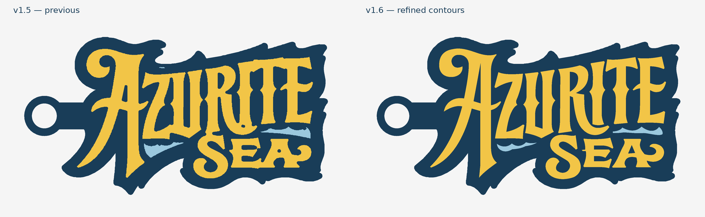
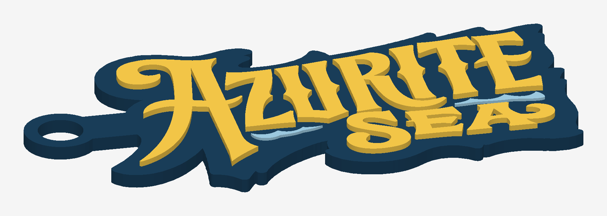
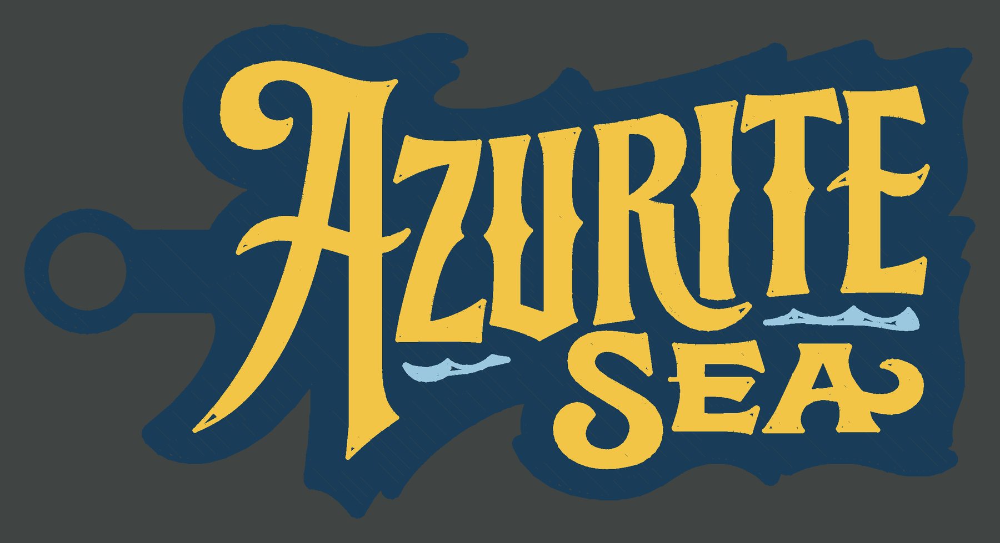

# Azurite Sea v1.6

Open [Set_06_Azurite_Sea_v1.6.3mf](Set_06_Azurite_Sea_v1.6.3mf) **as a project** in Bambu Studio to keep the three filament assignments and print profiles.

The lettering and wave accents are rebuilt from smooth vector contours traced against the [archived original artwork](../../../collection/v1.0/Sources/lorcana-keychains/sources/06.png). The large A now has its long tapered counter; the A in SEA has its triangular counter; and the R bowl is more open. All ten gold letters have independent contours, removing the accidental Z/U, R/I, I/T, T/E and E/A joins. The small texture holes in the R leg and E are removed, along with the stray ice-blue fleck above the Z.

Both wave accents now follow the original three crests and swept foam edges. The dark teal area beneath the foam remains the backing colour rather than becoming a solid ice-blue wedge. Fine white highlights from the source are represented by the wave silhouette within the existing three-colour palette.

Print clearances take priority at the tightest original joins. The minimum measured gold-letter separation is **0.460 mm**, with **0.645 mm** between the E and A in SEA. Pointed counters and serif tips retain their taper; the nozzle determines their last printable detail.

The original v1.5 **2 mm backing and loop**, **6.5 mm bore**, **10.5 mm nominal outer diameter** and **2 mm nominal radial rim** are preserved exactly. Ice-blue relief remains **0.4 mm**, gold relief **0.8 mm**, and total height **2.8 mm**. Placement, filament assignments and the embedded **Bambu A1 / 0.4 mm nozzle / 0.20 mm layers / Arachne** settings are preserved.

Bambu Studio 02.08.02.61 imports and slices successfully with all three filaments and no plate warnings. Mesh checks find no self-intersections, degenerate triangles, unsupported relief or overlapping colours. Actual deposited toolpaths were checked at 0.025 mm resolution: all four gold layers retain ten separate continuous letters and open counters, and both ice-blue layers retain two continuous waves with no detached deposits. These are geometry and slicer checks; physical printing has not been tested.







[Validation_v1.6.json](Validation_v1.6.json) contains the geometry, project hashes and slice results. The editable contours are in [set06_clean_artwork.svg](../../../tools/set06_clean_artwork.svg). The unsliced 3MF remains the deliverable; G-code is retained only as validation evidence under `validation/Set_06_Azurite_Sea/v1.6/`.

Rebuild and validate from the repository root using Python with NumPy and Pillow, the system GLU/Cairo libraries, and local Bambu Studio:

```sh
python3 tools/rebuild_set06.py --version v1.6
python3 tools/validate_set06.py --version v1.6
```
