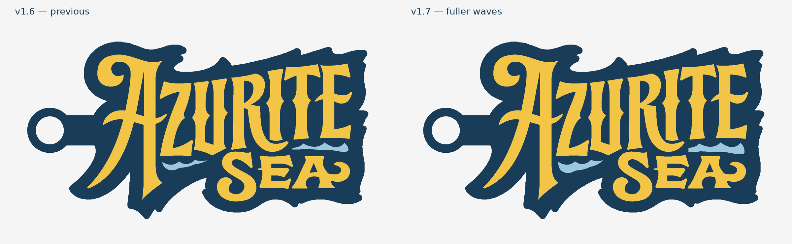
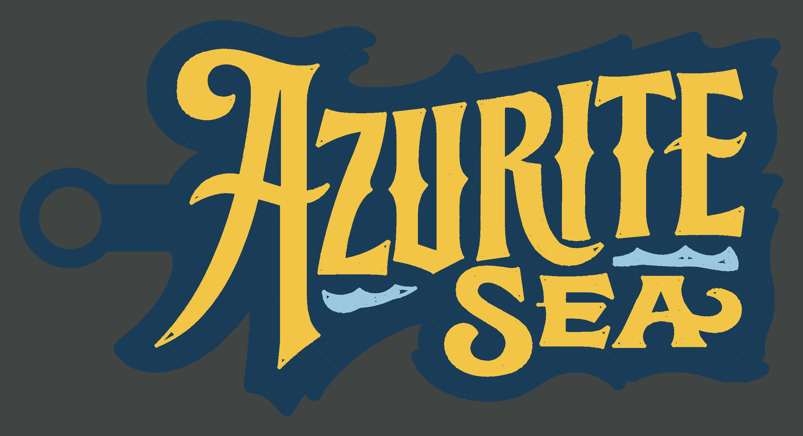

# Azurite Sea v1.7

Open [Set_06_Azurite_Sea_v1.7.3mf](Set_06_Azurite_Sea_v1.7.3mf) **as a project** in Bambu Studio.

Both ice-blue waves are fuller in the XY plane. Their lower swept edges extend downwards by about **0.5–0.6 mm**, while the v1.6 upper crests are preserved exactly. Blue area increases by **61.5% on the left** and **55.8% on the right**. Minimum clearance to the gold is **1.189 mm** and **0.905 mm**, respectively.

The gold lettering, backing, loop, filament assignments, placement and print profiles are preserved exactly from v1.6. Ice-blue relief stays **0.4 mm high**; the overall height remains **2.8 mm**. The adjustment adds width to the waves rather than increasing their height.

Bambu Studio 02.08.02.61 slices with the embedded **A1 / 0.4 mm nozzle / 0.20 mm layers / Arachne** profile, all three colours and no plate warnings. Both waves form continuous deposits on both ice-blue layers, with no detached deposits. All ten letters remain separate and continuous on all four gold layers, and all three counters stay open. Meshes are closed manifold solids without degenerate faces, intersections, unsupported relief or overlapping colours. Physical printing has not been tested.





[Validation_v1.7.json](Validation_v1.7.json) records geometry and slice evidence. Edit the wave contours in [set06_thicker_waves.svg](../../../tools/set06_thicker_waves.svg). Reproduce with NumPy, Pillow, system GLU/Cairo and local Bambu Studio:

```sh
python3 tools/rebuild_set06.py
python3 tools/validate_set06.py
```
