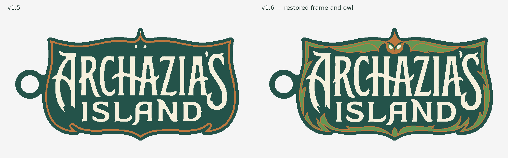
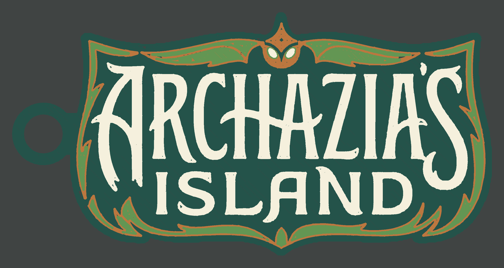

# Archazia's Island v07

The saved v07 project in this folder uses the Classic profile. The historical validation below covers the original Arachne build. See [v08](../v08/README.md) for the Arachne project and its current toolpath report.

Open [Set_07_Archazias_Island_v07.3mf](Set_07_Archazias_Island_v07.3mf) **as a project** in Bambu Studio to retain all four colour assignments.

The light green frame is restored around the full title, including the upper feather flourishes, side points, lower swept leaves and centre ornament. Caramel borders and feather veins frame the green areas. The owl now has a caramel head and crest, an engraved brow and beak, two shaped green eye sockets and separate ivory eyes. Its head follows the source silhouette rather than leaving the eyes as isolated dots.

The lettering is traced from the archived original artwork, with smooth contours and all six original counters. The original H/A crossbar and A/S flourish are retained; the narrow A/S connection is locally reinforced to survive the 0.4 mm nozzle. Fine texture and the stray ivory fleck at the owl crest are removed.

The native backing and loop are preserved exactly: **2 mm height**, **6.5 mm bore**, **10.5 mm nominal outer diameter** and **2 mm radial rim**. Overall size remains **80.525 × 40.815 × 3 mm**. Caramel rises to Z=2.6 mm, light green to Z=2.8 mm and ivory to Z=3 mm. Green rests on caramel; the eyes rest on their green sockets. The existing plate position, A1 / 0.4 mm nozzle / 0.20 mm layers / Arachne process and first three material profiles are retained.

| Slot | Filament | Features |
| --- | --- | --- |
| 1 | Dark Green | Backing and loop |
| 2 | Caramel | Frame trim, feather veins and owl face |
| 3 | Ivory White | Lettering and owl eyes |
| 4 | Mistletoe Green | Light green frame and eye sockets |

Slot 4 copies the existing Bambu PLA Matte profile. The project includes the expanded four-colour purge matrix and filament metadata.





Bambu Studio 02.08.02.61 imports and slices with all four intended colours and no plate warnings. The meshes are closed manifold solids with no degenerate triangles, intersecting contours, unsupported relief or overlapping colour volumes. Actual toolpaths retain all 14 lettering components on all five relief layers, all six open counters, both separate eyes, all 12 green frame/socket components and the open brow/beak engraving. Raster reconstruction allows 0.075 mm at bead edges; connected lettering covers at least 99.4% of its sampled stroke cores and green covers 99.8%. Physical printing has not been tested.

[Validation_v07.json](Validation_v07.json) records geometry, profile preservation, project/source hashes and toolpath checks. [Isometric preview](Set_07_Archazias_Island_v07_isometric.png) shows the actual relief geometry. Earlier projects remain in their version folders.

Edit [set07_clean_artwork.svg](../../../tools/set07_clean_artwork.svg) to refine the source-registered artwork. Reproduce from the project root with NumPy, Pillow, system Cairo/GLU and the local Bambu Studio runtime:

```sh
python3 tools/rebuild_set07.py
python3 tools/validate_set07.py
```
