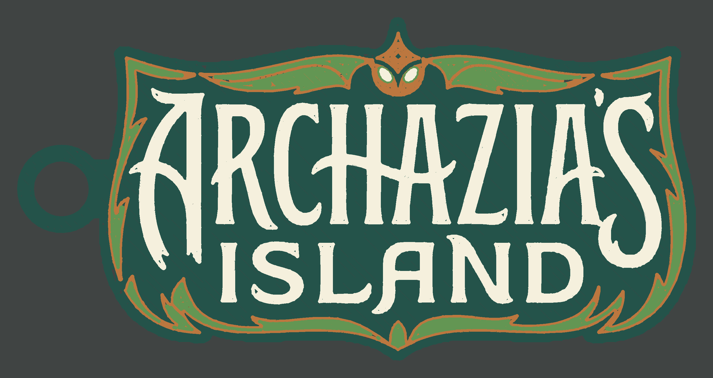

# Archazias Island v08

Open [Set_07_Archazias_Island_v08.3mf](Set_07_Archazias_Island_v08.3mf) as a Bambu Studio project.

Bambu Lab A1, 0.4 mm nozzle, 0.20 mm layers, Arachne with 3 wall loops, 5 top and 5 bottom layers, 15% grid infill, Textured PEI, supports off, no brim, and prime tower enabled. The filament profiles and colour assignments are those of the original v07 build.

The [v07 artwork](../v07_approved/README.md), geometry, plate placement, and filament slot assignments carry over. The [v07 project with its saved settings](../v07_approved/Set_07_Archazias_Island_v07.3mf) is available for comparison.

The existing toolpath audit passes for the lettering, feathered frame, and owl engraving. The v07 Classic profile fell below the lettering coverage threshold on the first relief layer. Bambu Studio 02.09.01.70 sliced v08 with all 4 colours and no plate warnings. The v08 validation covers geometry preservation and slicer output. A physical print has yet to be recorded.

[Validation report](Validation_v08.json) · [Slicer output](../../../validation/Set_07_Archazias_Island/v08/result.json) · [Slicer log](../../../validation/Set_07_Archazias_Island/v08/slice.log) · [G-code](../../../validation/Set_07_Archazias_Island/v08/plate_1.gcode)
