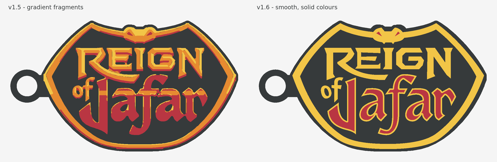

# Reign of Jafar v07

Open [Set_08_Reign_of_Jafar_v07.3mf](Set_08_Reign_of_Jafar_v07.3mf) **as a project** in Bambu Studio to retain the colour assignments and print settings.

The gradient bands, bevel fragments and scattered colour slivers are replaced with solid colours. The outer rim is redrawn as a smooth, continuous gold band. “Reign of” is solid gold; “Jafar” has solid red faces with a uniform **0.45 mm gold outline**, including the letter counters. The snake retains two red eyes. The final “r” has a locally widened join so its red face prints continuously.

The original backing and loop are preserved exactly: **2 mm height**, **6.5 mm bore**, **10.5 mm nominal outer diameter** and **2 mm radial rim**. Overall size remains **71.905 × 41.54 × 2.8 mm**. The gold beneath “Jafar” reaches Z=2.4 mm, with red faces above it to Z=2.8 mm. The gold title and rim also reach Z=2.8 mm.

| Existing slot | Filament | Features |
| --- | --- | --- |
| 1 | Charcoal | Backing and loop |
| 3 | Sunflower Yellow | Rim, “Reign of” and “Jafar” outlines |
| 4 | Red | “Jafar” faces and snake eyes |

All original filament and process settings are byte-for-byte preserved, including the A1 / 0.4 mm nozzle / 0.20 mm Arachne process and plate placement. Slot 2 (Pumpkin Orange) remains in the settings but is unused; it does not need filament loaded for this project.




Bambu Studio imports and slices with three active colours and no plate warnings. Validation checks the closed manifold meshes, supported relief, separated letters, open counters, continuous rim, connected red faces and visible gold outlines against the actual G-code. [Validation_v07.json](Validation_v07.json) records the results and project/source hashes. Physical printing has not been tested.

Edit [set08_clean_artwork.svg](../../../tools/set08_clean_artwork.svg) to refine the source-registered curves. Earlier versions remain in their folders. Reproduce from the project root using Python 3, system Cairo/GLU and the local Bambu Studio runtime:

```sh
python3 tools/rebuild_set08.py
python3 tools/validate_set08.py
```
