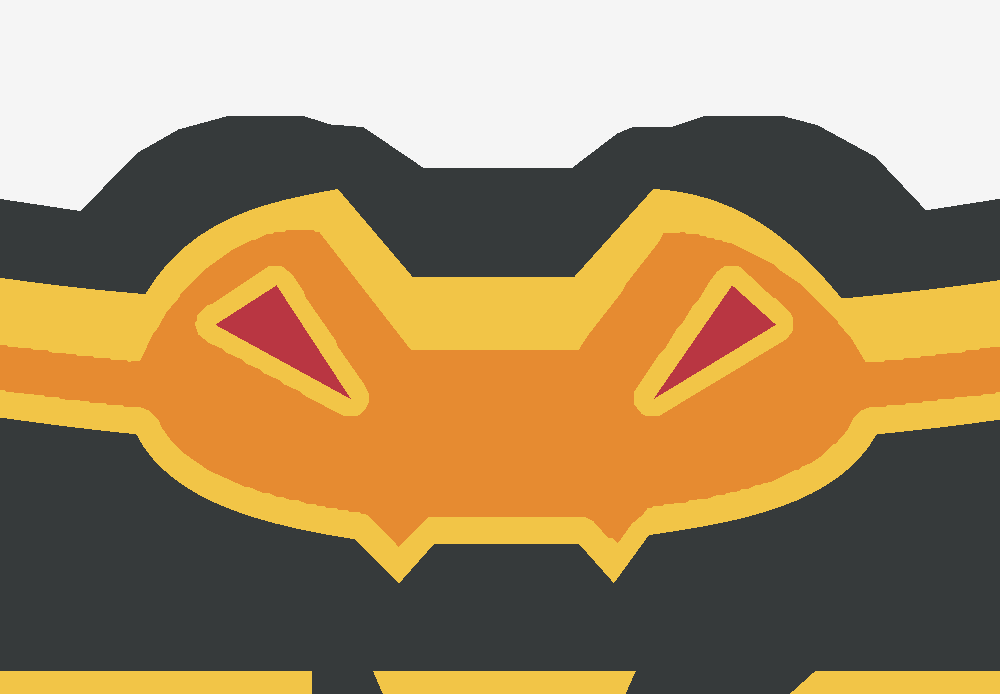
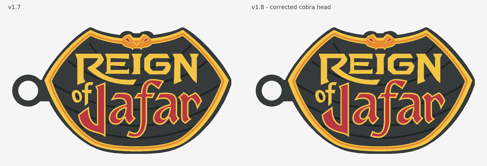
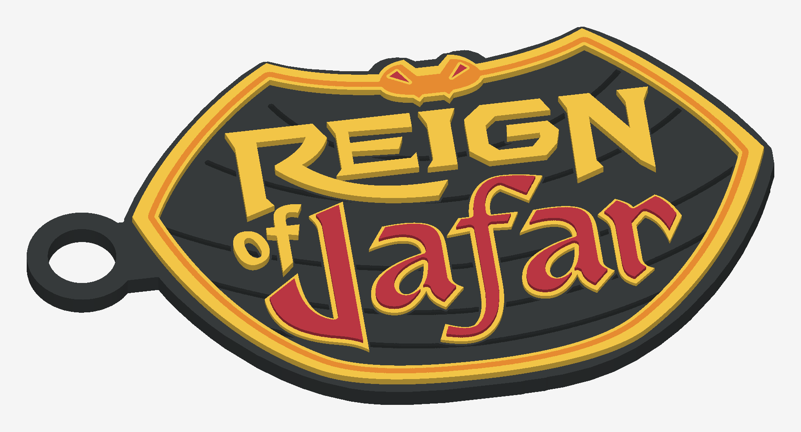

# Reign of Jafar v09

Open [Set_08_Reign_of_Jafar_v09.3mf](Set_08_Reign_of_Jafar_v09.3mf) **as a project** in Bambu Studio.

The added central V is removed. Checking the [archived original artwork](../../../collection/v01/Sources/lorcana-keychains/sources/08.png) confirms a plain orange face between the eyes. The gold eye surrounds, red eyes and two lower fang points are retained.



The orange rim, five engraved cobra-hood bands, lettering, backing and eyelet retain their v08 geometry. Only the small gold chevron is replaced with orange. All four filament slots, process settings and placement are retained. Dimensions remain **71.905 × 41.54 × 2.8 mm**, with a **2 mm loop**, **6.5 mm bore**, and **1.6 mm backing floor** beneath the 0.4 mm deep hood engravings.





Bambu Studio imports and slices using all four colours with no plate warnings. Validation confirms that the centre of the head prints entirely orange on both face layers, with no gold interruption. It also checks that changes from v08 stay within the small central face region, that the hood grooves remain open, and that the rim, eyes, lettering and gold outlines survive slicing. The meshes are closed manifold solids with no degenerate triangles. Physical printing has not been tested.

[Validation_v09.json](Validation_v09.json) records geometry, toolpath checks and source/project hashes. [Actual sliced preview](Set_08_Reign_of_Jafar_v09_sliced_preview.png) shades the recessed black floors darker to show depth; they use the same Charcoal filament.

Reproduce with Python 3, system Cairo/GLU and local Bambu Studio:

```sh
python3 tools/rebuild_set08_v09.py
python3 tools/validate_set08_v09.py
```

The builder uses the existing v07 project as its lettering prerequisite and compares the result with preserved v08. [set08_serpent_detail_v09.svg](../../../tools/set08_serpent_detail_v09.svg) holds the corrected detail artwork. Earlier projects remain in their folders.
