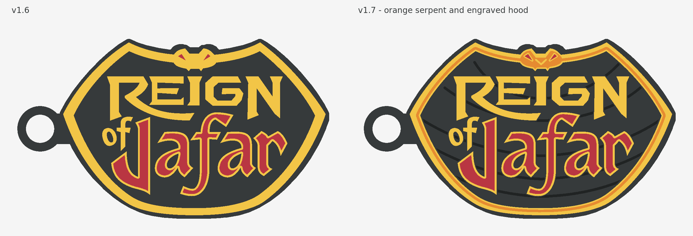
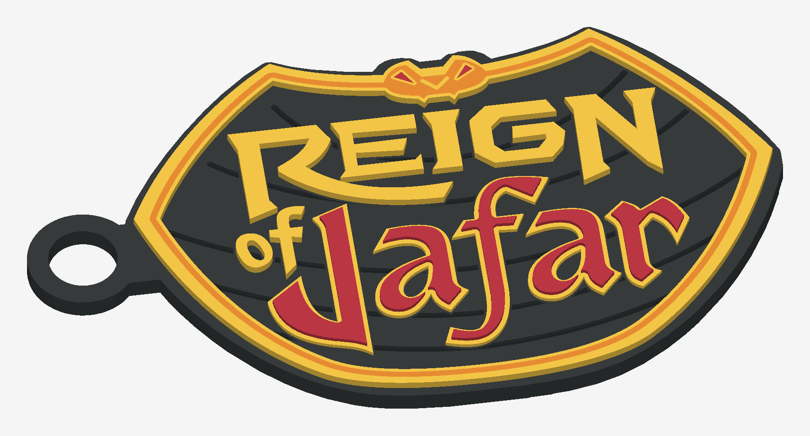

# Reign of Jafar v1.7

Open [Set_08_Reign_of_Jafar_v1.7.3mf](Set_08_Reign_of_Jafar_v1.7.3mf) **as a project** in Bambu Studio to retain all four colour assignments.

A continuous **0.6 mm orange inset** follows the smooth gold outer rim. The serpent head now has orange cheeks, gold eye surrounds and a gold forehead/muzzle chevron, with the original red eyes retained. These are solid colour regions with no gradients.

The cobra's five curved hood bands are restored from the original artwork as **0.6 mm wide, 0.4 mm deep engravings** in the black background. They pass behind the lettering and stop short of the raised artwork. The grooves use the same Charcoal filament as the backing; the previews shade their floors darker to show depth. Appearance in a physical print will depend on lighting.

The v1.6 gold lettering, “Jafar” outlines, red lettering and red eyes are preserved exactly. The native backing silhouette, plate placement and eyelet dimensions are retained: **2 mm loop height**, **6.5 mm bore**, **10.5 mm nominal outer diameter** and **2 mm radial rim**. The backing remains 2 mm thick outside the engravings, with a **1.6 mm backing floor below each groove**. Overall size remains **71.905 × 41.54 × 2.8 mm**.

| Slot | Filament | Features |
| --- | --- | --- |
| 1 | Charcoal | Backing, loop and engraved cobra hood |
| 2 | Pumpkin Orange | Inset rim and serpent cheeks |
| 3 | Sunflower Yellow | Gold rim, serpent highlights, “Reign of” and “Jafar” outlines |
| 4 | Red | “Jafar” faces and serpent eyes |

All four original filament profiles and the A1 / 0.4 mm nozzle / 0.20 mm Arachne process settings are byte-for-byte preserved. Orange uses the existing slot 2.






Bambu Studio 02.08.02.61 imports and slices using all four colours with no plate warnings. Meshes are closed manifold solids with no degenerate triangles or overlapping colour volumes. G-code checks confirm all five hood bands remain open on both layers above their floors, the orange rim and head form one continuous deposit on both orange layers, and the gold head highlights, letter counters and “Jafar” outlines survive slicing. Physical printing has not been tested.

[Validation_v1.7.json](Validation_v1.7.json) records geometry, toolpath checks and project/source hashes. Edit [set08_serpent_detail.svg](../../../tools/set08_serpent_detail.svg) for the orange face and hood curves. Reproduce from the project root with Python 3, system Cairo/GLU and local Bambu Studio:

```sh
python3 tools/rebuild_set08_v1_7.py
python3 tools/validate_set08_v1_7.py
```

The builder starts from the preserved v1.6 project. To regenerate that prerequisite, run `python3 tools/rebuild_set08.py` first. Earlier versions remain in their folders.
