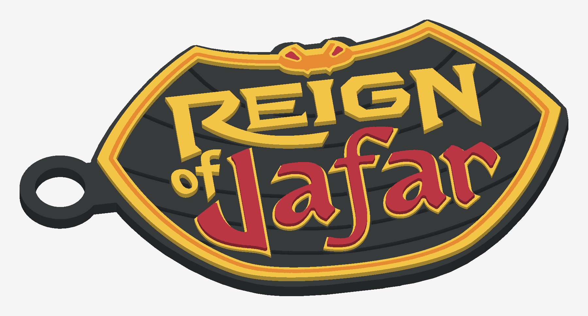

# Reign of Jafar v10

Open [Set_08_Reign_of_Jafar_v10.3mf](Set_08_Reign_of_Jafar_v10.3mf) **as a project** in Bambu Studio to retain the filament assignments and print settings. This revision is preserved as reviewed; no further model changes were made during documentation closeout.

Compared with v09:

- Fuller, rounded red eyes improve coverage inside the gold surrounds. The orange face remains plain, without the central V.
- The Jafar gold outlines narrow from 0.45 to 0.35 mm, and the two “a” openings shrink slightly to strengthen the surrounding red strokes. Red lettering now has three 0.2 mm layers, ending at 3 mm.
- All five engraved cobra-hood bands extend to the inner rim. The continuous orange border and gold trim are retained.




The overall dimensions are **71.905 × 41.54 × 3 mm**. The eyelet retains its **2 mm height, 6.5 mm bore and nominal 10.5 mm outer diameter**. The 0.4 mm deep background engravings leave a 1.6 mm backing floor.

Filament slots remain **1 Charcoal, 2 Orange, 3 Gold, 4 Red**. The A1 / 0.4 mm nozzle profile, 0.2 mm layer height, Arachne walls and placement are retained. The red part overrides top-surface and internal-solid-infill line widths to **0.35 mm**; the global project settings are unchanged from v09.

## Validation and remaining detail

Bambu Studio imports and slices this exact project successfully, using all four colours, with **no plate warnings**. All four meshes passed the closed-manifold and degenerate-triangle checks. The recorded toolpath checks passed eye coverage and continuous red rings around both “a” openings on all three red lettering layers.

The strict custom audit did **not** pass in full: it found two small areas where the simulated deposited red beads leave gold exposed through every red layer:

| Location | Estimated area | Model-space centre (mm) |
| --- | ---: | --- |
| Near the “f” crest | 0.05984 mm² | 46.08387, 23.73751 |
| On an “a” | 0.02609 mm² | 51.45791, 15.50160 |

These estimates come from a 0.025 mm raster projection of the sliced extrusion paths. They exceed the audit's 0.02 mm² threshold; they are not observations from a physical print. Physical printing remains untested. No additional design feature is pending, and these residual gaps are recorded without further model changes.

The matching [Bambu result](../../../validation/Set_08_Reign_of_Jafar/v10/result.json), [slice log](../../../validation/Set_08_Reign_of_Jafar/v10/slice.log) and [G-code](../../../validation/Set_08_Reign_of_Jafar/v10/plate_1.gcode) are retained. The strict validator stops at the residual-gap assertion, so this folder has no full-pass validation report.

Project SHA-256, matching the [recorded slice hash](../../../validation/Set_08_Reign_of_Jafar/v10/project.sha256):

```text
5532638232d5e2b429246d1d26b1cf6b93e6fa6a8438d6ca49fcd2f81f6151d6
```

## Reproduction

The existing v09 project is the builder's source. Python 3, system Cairo/GLU and local Bambu Studio are required.

```sh
python3 tools/rebuild_set08_v10.py
python3 tools/validate_set08_v10.py
```

The validation command currently exits with the two residual gaps listed above. Neither command was rerun for documentation closeout. Earlier projects and their reports remain in their version folders.
