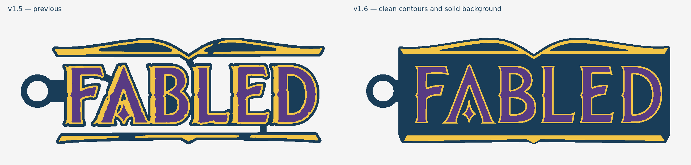

# Fabled v07

The saved v07 project in this folder uses the Classic profile. The historical validation below covers the original Arachne build. See [v08](../v08/README.md) for the Arachne project and its current toolpath report.

Open [Set_09_Fabled_v07.3mf](Set_09_Fabled_v07.3mf) **as a project in Bambu Studio** to retain the three filament assignments and embedded A1 / 0.4 mm nozzle settings.

This revision replaces the rough colour-threshold trace with explicit closed Bézier contours and adds a solid Marine Blue background. The open book above the title, all six letters, the star inside the A and the underline now sit on one continuous book-shaped backing. The gold book and underline are complete; the letters have smooth edges and nominal **0.50 mm gold borders** around their purple faces.


Compared with and based on [v06](../v06/Set_09_Fabled_v06.3mf). The [labelled comparison](Set_09_Fabled_v07_comparison.png) renders both saved projects at the same physical scale, orientation and framing. The fine doubled hairlines along the original letter spines are simplified into printable gold borders; the [source overlay](Set_09_Fabled_v07_source_overlay.png) shows the clean contours registered against the supplied artwork.



The new backing has **2,697.81 mm²** of material in its footprint, up from **1,945.32 mm²** in v06: **752.49 mm² / 38.68% more backing area**. The former gaps between the title and ornaments are filled. A **7 mm wide neck** joins the background to the eyelet. The eyelet is the only through-hole; the openings in B and D reveal the blue backing.

| Feature | Dimensions / assignment |
| --- | --- |
| Overall envelope | 94.69 × 33.37 × 3.00 mm |
| Backing and loop | 2.00 mm high, Marine Blue, slot 1 |
| Eyelet | 6.50 mm bore, nominal 10.50 mm outside, 2.00 mm radial rim |
| Hole and centre | Every v06 bore coordinate preserved exactly |
| Gold lettering and ornaments | Z = 2.00–2.60 mm, Sunflower Yellow, slot 2 |
| Purple letter faces and A star | Z = 2.60–3.00 mm, Purple, slot 3 |
| Purple counters | Two in B, one in D |

The colour volumes meet at their faces without overlapping. Gold supports the purple caps; blue supports all gold artwork. All three original filament profiles, process settings, assembly placement and build placement are retained. No additional filament is required.


Validation uses the actual saved 3MF, followed by a Bambu Studio **02.08.02.61** slice with the embedded **A1, 0.4 mm nozzle, 0.2 mm layers, Arachne** settings:

- All three colour meshes are closed manifolds with positive volume, zero degenerate triangles and simple, nonintersecting contours.
- The backing is one connected solid with one hole. Unsupported relief pixels: **0** at 0.025 mm raster resolution. The circular eyelet's sampled radial rim is 2 mm.
- Bambu imports and slices successfully, uses all three filament slots and reports **no plate warnings**.
- The top backing layer is one connected deposit, covering **99.9925%** of the audited interior. Eyelet toolpaths reach 2 mm and do not extend above it.
- Each gold layer, Z = 2.2 / 2.4 / 2.6 mm, has exactly **nine connected features**: six letters, the A star and two ornaments. Visible gold border cores have **100%** connected coverage; the minimum across borders and ornaments is **99.8805%**. Both book openings and all three letter counters stay clear.
- Each purple layer, Z = 2.8 / 3.0 mm, has exactly **seven connected features**, with no detached or merged components and all three counters clear. Minimum audited core coverage is **99.8757%**.

Coverage checks allow 0.075 mm for raster reconstruction of bead edges. Purple cores exclude a 0.12 mm edge strip; exposed gold border cores exclude 0.12 mm from each side. Ornaments use a 0.18 mm inset. The full gold star's buried infill core has 98.6010% coverage, while its exposed gold outline has 100%; small internal infill voids beneath the purple cap are distinguished from broken visible contours. These checks establish continuity and coverage, not a perfectly void-free surface or a physical print result.


[Geometry report](Geometry_v07.json) · [Validation report](Validation_v07.json) · [Build/input hashes](Build_manifest.json) · [Slicer log](../../../validation/Set_09_Fabled/v07/slice.log) · [Slice result](../../../validation/Set_09_Fabled/v07/result.json) · [G-code evidence](../../../validation/Set_09_Fabled/v07/plate_1.gcode)

Physical printing and chain fit have **not been tested**. The images above are model renders and a reconstructed toolpath preview, not photographs.

Reproduce without overwriting the saved project:

```sh
python3 tools/rebuild_set09.py --output-dir /tmp/lorcana-set09-v07-reproduction
python3 tools/validate_set09.py --project /tmp/lorcana-set09-v07-reproduction/Set_09_Fabled_v07.3mf
```

Requires Python 3.12+, NumPy, Pillow, system Cairo/GLU and the installed Bambu Studio Flatpak runtime. The Python bundled with the local Codex runtime was used for this build because the system Python does not have NumPy/Pillow. The builder refuses to overwrite an existing model; choose a fresh output directory for another reproduction. Running the builder without `--output-dir` targets this saved version and therefore refuses to overwrite it.

Editable artwork: [tools/set09_clean_artwork.svg](../../../tools/set09_clean_artwork.svg). Generator: [tools/rebuild_set09.py](../../../tools/rebuild_set09.py). Validator: [tools/validate_set09.py](../../../tools/validate_set09.py). [Sources/](Sources/) preserves the exact artwork, scripts and imported helpers used for this revision, with hashes in the build manifest. Run the snapshots from the [pre-migration checkout](../../../CHANGELOG.md#version-renumbering), which contains the paths those scripts expect. Geometry is reproducible; ZIP timestamps may change the 3MF archive's byte hash.

[Set navigation](../README.md) · [Full changelog](../CHANGELOG.md)
