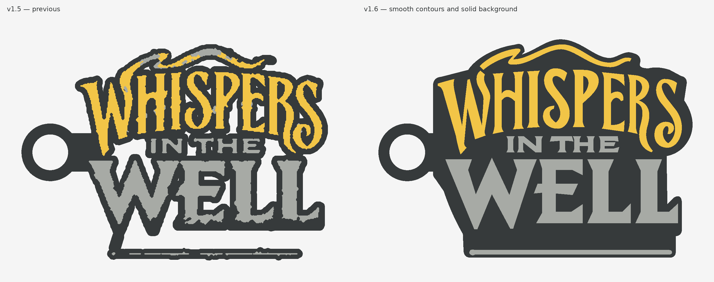
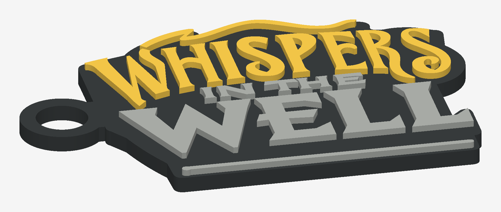

# Whispers in the Well v1.6

The saved v1.6 project in this folder uses the Classic profile. The historical validation below covers the original Arachne build. See [v1.7](../v1.7/README.md) for the Arachne project and its current toolpath report.

Open [Set_10_Whispers_in_the_Well_v1.6.3mf](Set_10_Whispers_in_the_Well_v1.6.3mf) **as a project in Bambu Studio** to retain the three filament assignments and embedded A1 / 0.4 mm nozzle settings.

This revision replaces the rough raster tracing with explicit closed Bézier contours and fills the gaps between the lettering and ornaments with a continuous Charcoal field. WHISPERS, IN THE and WELL have clean, complete contours. The upper gold wisp and lower grey rule are complete shapes. The P and R openings reveal the backing; the eyelet is the only through-hole.


Compared with and based on [v1.5](../v1.5/Set_10_Whispers_in_the_Well_v1.5.3mf). The labelled comparison renders both saved projects at the same physical scale, orientation and framing. Fine highlights, stone cracks, small chipped edges and doubled hairlines in the supplied raster are simplified into printable solid fills. The first S has a fuller upper bowl and lower curl to reduce underfilled toolpaths. The [source overlay](Set_10_Whispers_in_the_Well_v1.6_source_overlay.png) shows how the redrawn artwork relates to the supplied reference.



The backing footprint increases from **1,304.53 to 1,641.65 mm²**, adding **337.12 mm² / 25.84%**. Its 20 previous through-openings are reduced to the eyelet alone. The field supports all artwork and joins the eyelet through a **7 mm wide neck**.

| Feature | Dimensions / assignment |
| --- | --- |
| Overall envelope | 57.17 × 39.72 × 2.80 mm; previously 55.78 × 39.38 × 2.80 mm |
| Backing and loop | Z = 0–2.00 mm, Charcoal, slot 1 |
| Subtitle, WELL and lower rule | Z = 2.00–2.80 mm, Ash Gray, slot 2 |
| WHISPERS and upper wisp | Z = 2.00–2.80 mm, Sunflower Yellow, slot 3 |
| Eyelet | 6.50 mm bore, nominal 10.50 mm outside, 2.00 mm radial rim |
| Hole coordinates and centre | Every v1.5 bore vertex preserved exactly |

The relief colours occupy separate volumes, supported directly by the backing. Filament and process settings are byte-identical to v1.5; assembly and build placement are preserved.



Validation reads the actual saved 3MF and slices it with Bambu Studio **02.08.02.61**, using the embedded **A1, 0.4 mm nozzle, 0.2 mm layers, Arachne** profile:

- All three colour meshes are closed manifolds with positive volume, zero degenerate triangles and simple contours. The backing has one connected footprint and one hole. Unsupported relief pixels and overlapping colour pixels: **0** at 0.025 mm raster resolution.
- Bambu imports and slices successfully, uses all three filament slots and reports **no plate warnings**. The loop deposits reach 2 mm and stop there.
- The top backing layer is one connected deposit with **99.9719%** coverage of the audited interior.
- Each relief layer at Z = 2.2 / 2.4 / 2.6 / 2.8 mm has exactly **10 connected grey features** and **9 connected gold features**, with no detached or merged deposits. The P and R counters remain clear on every layer.
- Minimum audited connected core coverage across all layers is **99.6892% grey** and **99.2847% gold**.

The coverage audit excludes a 0.12 mm edge strip from each relief feature and allows 0.075 mm for raster reconstruction of bead edges. The background audit uses a 0.28 mm inset. Geometry connectivity excludes 0.075 mm at the boundary to avoid isolated raster pixels at acute serif tips; the model contours and deposited feature counts are checked separately. Small infill and seam voids remain visible in the toolpath reconstruction; the checks establish connected strokes and core coverage, not a perfectly void-free surface. Physical printing and chain fit have **not been tested**.


[Geometry report](Geometry_v1.6.json) · [Validation report](Validation_v1.6.json) · [Build/input hashes](Build_manifest.json) · [Slicer log](../../../validation/Set_10_Whispers_in_the_Well/v1.6/slice.log) · [Slice result](../../../validation/Set_10_Whispers_in_the_Well/v1.6/result.json) · [G-code](../../../validation/Set_10_Whispers_in_the_Well/v1.6/plate_1.gcode)

Reproduce in a fresh directory without overwriting the saved release:

```sh
python3 tools/rebuild_set10.py --output-dir /tmp/lorcana-set10-v1.6-reproduction
python3 tools/validate_set10.py --project /tmp/lorcana-set10-v1.6-reproduction/Set_10_Whispers_in_the_Well_v1.6.3mf
```

Requires Python 3.12+, NumPy, Pillow, system Cairo/GLU and the installed Bambu Studio Flatpak runtime. This build used `/home/deck/.cache/codex-runtimes/codex-primary-runtime/dependencies/python/bin/python3.12`; system Python lacks NumPy/Pillow. The builder refuses to overwrite a saved model. Geometry is reproducible; ZIP timestamps may change archive hashes.

Editable artwork: [set10_clean_artwork.svg](../../../tools/set10_clean_artwork.svg). [Builder](../../../tools/rebuild_set10.py) · [Validator](../../../tools/validate_set10.py). [Sources/](Sources/) preserves the exact scripts, helper modules and supplied artwork used, with hashes in the build manifest. The snapshot scripts can also run directly from the project root: replace `tools/` in the reproduction commands with `sets/Set_10_Whispers_in_the_Well/v1.6/Sources/`.

[Set navigation](../README.md) · [Full changelog](../CHANGELOG.md)
