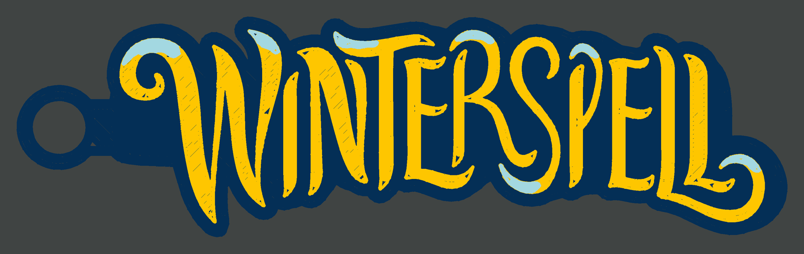

# Winterspell v09

Open the [Bambu Studio project](Set_11_Winterspell_v09.3mf) at **100% scale** with the **A1 0.4 mm nozzle** and the saved 0.20 mm Arachne process.

The background uses a single Dark Blue filament. Seven Ice Blue caps sit on selected letter curves, following the frosty patches in the original artwork. The Sunflower Yellow lettering uses the v08 mesh. Each cap is 0.4 mm high, bringing the total thickness to 3.4 mm. The keychain measures 94.94 × 27.23 mm across the face and has a 6.5 mm loop bore. [Archived artwork](../../../collection/v01/Sources/lorcana-keychains/sources/11.png)

| AMS slot | Filament |
| --- | --- |
| 1 | PLA Matte Dark Blue |
| 2 | PLA Basic Sunflower Yellow |
| 3 | PLA Matte Ice Blue |

[Before and after](Set_11_Winterspell_v09_comparison.png) · [Top view](Set_11_Winterspell_v09_preview.png) · [Isometric view](Set_11_Winterspell_v09_isometric.png)



Bambu Studio sliced the project without plate warnings. All eleven letters appeared on each gold layer, and all seven snow caps were connected on both Ice Blue layers. The cap part uses narrower walls and top fill to preserve the small shapes. Physical print quality and fit remain unverified. [Geometry](Geometry_v09.json) · [Validation](Validation_v09.json) · [Raw slice](../../../validation/Set_11_Winterspell/v09/)

## Reproduce

Run from the project root with Python, NumPy, Pillow, Shapely, system Cairo/GLU, and Bambu Studio Flatpak.

```sh
python3 tools/snow_set11.py --output-dir /tmp/winterspell-v09-reproduction
```

[Editable snow masks](../../../tools/set11_snow_caps.svg) · [Source snapshot](Source_snapshot.zip) · [Build inputs and hashes](Build_manifest.json)
