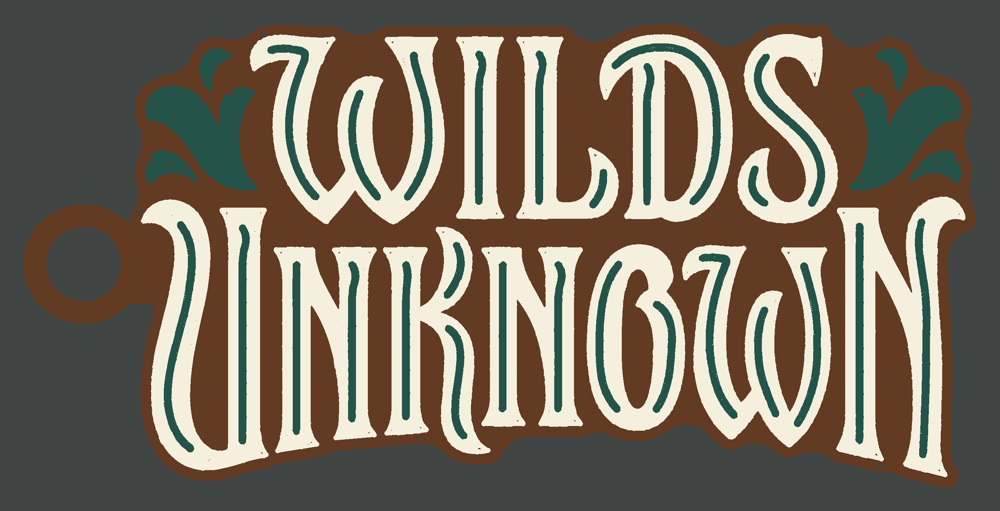

# Wilds Unknown v08

Open [Wilds Unknown v08](Set_12_Wilds_Unknown_v08.3mf) as a Bambu Studio project. It uses the saved A1 0.4 mm nozzle, 0.20 mm layer and Arachne process with the three original filament assignments.

The title has **26 rounded dark-green strokes across all 12 ivory letters**, traced from the original artwork. The strokes are nominally **0.72 mm wide** and sit flush with the ivory faces. Each green inlay is 0.40 mm deep with 0.60 mm of solid ivory beneath it. The shortest highlights at the tops of S and O were omitted to keep the accents legible as lines.

The continuous cocoa-brown backing, 6.5 mm eyelet, side foliage and letter outlines carry forward from [v07](../v07/Set_12_Wilds_Unknown_v07.3mf). Overall size is **82.91 × 40.47 × 3.00 mm**.

[Top view](Set_12_Wilds_Unknown_v08_preview.png) · [Isometric view](Set_12_Wilds_Unknown_v08_isometric.png) · [Comparison with v07](Set_12_Wilds_Unknown_v08_comparison.png)



Bambu Studio 2.9.1 sliced all three colours with no plate warnings. Both inlay layers contain 26 connected green strokes within the intended letter accents. The ivory remains connected around each stroke, with clear counters in D and O. The slicer estimated 36.7 minutes with six filament changes, compared with 33.0 minutes and four changes for v07. Physical print quality is unverified. [Validation report](Validation_v08.json) · [Slice result](../../../validation/Set_12_Wilds_Unknown/v08/result.json) · [CLI log](../../../validation/Set_12_Wilds_Unknown/v08/slice.log)

## Reproduction

The [editable green strokes](Sources/set12_green_accents.svg) use the coordinate system of the [archived title artwork](../../../collection/v01/Sources/lorcana-keychains/sources/12.png). The builder takes the ivory outlines and the backing from the saved v07 project. The [build manifest](Build_manifest.json) records the model and input hashes. From the project root, using Python with NumPy, Pillow and Shapely, system Cairo and GLU, and a local Bambu Studio installation:

```sh
python3 tools/rebuild_set12_v08.py --output-dir /tmp/lorcana-set12-v08-reproduction
python3 tools/validate_set12_v08.py --project /tmp/lorcana-set12-v08-reproduction/Set_12_Wilds_Unknown_v08.3mf
```
