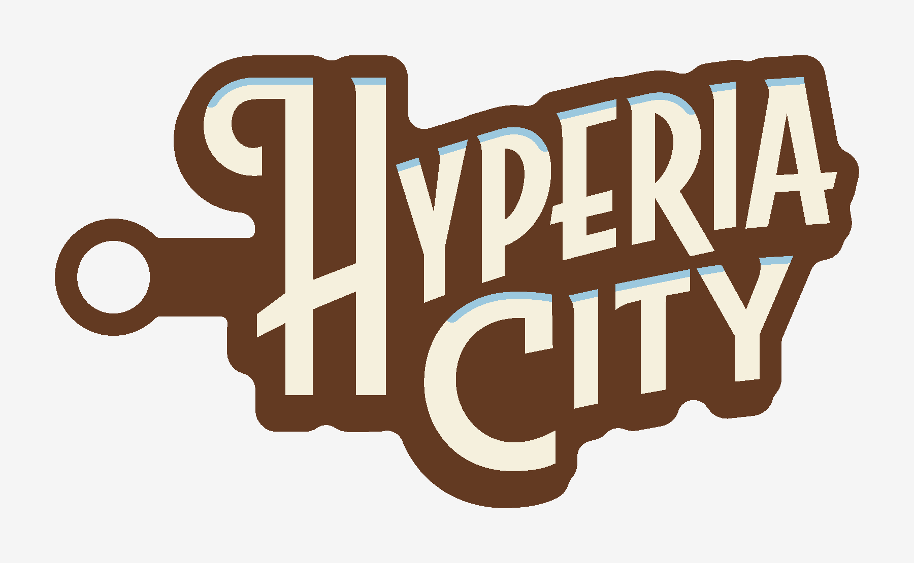

# Hyperia City v1.7

Open the [Bambu Studio project](Set_14_Hyperia_City_v1.7.3mf) to load the A1 and filament settings.

The Ivory White lettering sits directly on Cocoa Brown padding for stronger contrast. Ice Blue follows the upper edges of the letters, including the curved caps of H, P, R, and C. The blue prints as a single 0.20 mm layer above the ivory. The project uses three filament slots in order from Cocoa Brown to Ivory White to Ice Blue.

The keychain measures **71.90 × 40.56 × 3.00 mm**, with a 2 mm backing and eyelet, a 6.5 mm bore, and a nominal 10.5 mm outer eyelet diameter.



- [Matched-scale comparison with v1.6](Set_14_Hyperia_City_v1.7_comparison.png)
- [Isometric view](Set_14_Hyperia_City_v1.7_isometric.png)
- [Exported blue accents over the saved artwork](Set_14_Hyperia_City_v1.7_source_overlay.png)
- [Actual sliced toolpaths](Set_14_Hyperia_City_v1.7_sliced_preview.png)
- [Editable blue paths](Sources/set14_blue_highlights.svg) and [editable ivory letter paths](../v1.6/Sources/set14_clean_artwork.svg)

Bambu Studio sliced the full-size project with the A1 0.4 mm nozzle, 0.20 mm layers, and Arachne, with zero plate warnings. The toolpaths retain all 11 letters, all 14 upper-edge accents, the openings in P, R, and A, and the attachment bore. Physical printing is untested. [Validation report](Validation_v1.7.json) · [Slicer result](../../../validation/Set_14_Hyperia_City/v1.7/result.json)

## Reproduce

Build from the [v1.6 Bambu Studio project](../v1.6/Set_14_Hyperia_City_v1.6.3mf) and the editable paths. Run from the project root with NumPy, Pillow, Shapely 2.1 or newer, Cairo, GLU, and local Bambu Studio.

```sh
python3 tools/rebuild_set14_v1_7.py --output-dir /tmp/lorcana-set14-v17
python3 tools/validate_set14_v1_7.py --project /tmp/lorcana-set14-v17/Set_14_Hyperia_City_v1.7.3mf
```

[Source snapshot](Source_snapshot.zip) · [Build manifest](Build_manifest.json)
