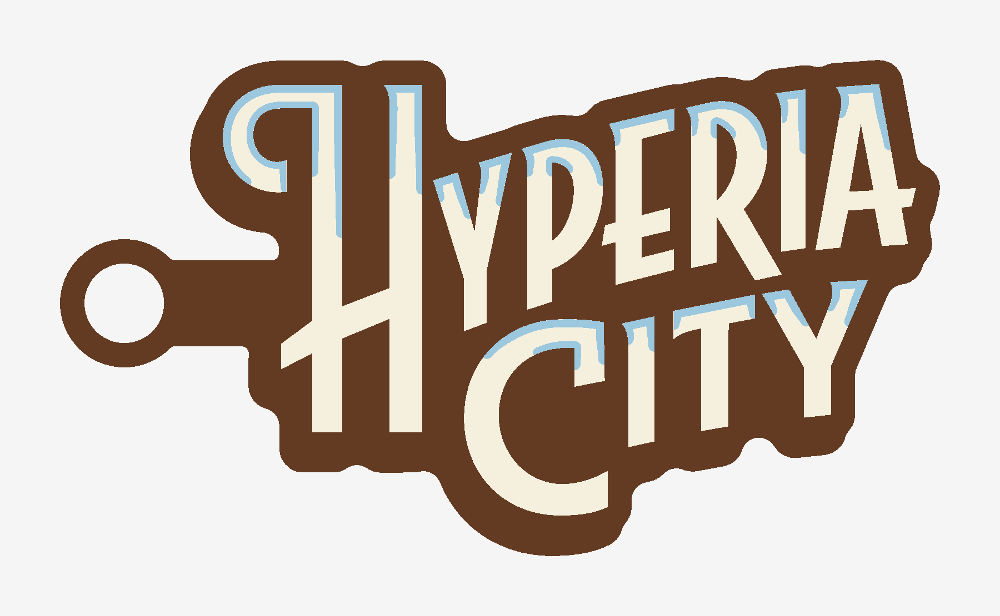

# Hyperia City v1.8

Open the [Bambu Studio project](Set_14_Hyperia_City_v1.8.3mf) to load the A1 and filament settings.

The Ice Blue follows the top contours and continues down the upper sides at the positions in the [annotated reference](../originals/Hyperia_City_blue_edge_reference.png). The H curl and C inner edge carry blue as well. Each accent narrows and ends in a rounded tip to suggest the fade in the original artwork with solid filament.

Ivory White sits directly on the dark Cocoa Brown padding. The model measures **71.90 × 40.56 × 3.00 mm**, with a 2 mm backing and 6.5 mm attachment bore. The Ice Blue part uses a 0.36 mm line-width override to keep the short turns connected on the 0.4 mm nozzle.



- [Matched-scale comparison with v1.7](Set_14_Hyperia_City_v1.8_comparison.png)
- [Isometric view](Set_14_Hyperia_City_v1.8_isometric.png)
- [Exported blue contours over the original artwork](Set_14_Hyperia_City_v1.8_source_overlay.png)
- [Actual sliced toolpaths](Set_14_Hyperia_City_v1.8_sliced_preview.png)
- [Editable blue contour paths](Sources/set14_blue_highlights.svg)

The full-size A1 slice at 0.20 mm layer height with Arachne reported zero plate warnings. All 18 blue accents and 11 letters are present, with openings in P, R, and A and the bore clear. Physical printing is untested. [Validation report](Validation_v1.8.json) · [Slicer result](../../../validation/Set_14_Hyperia_City/v1.8/result.json)

## Reproduce

Build from the [v1.7 project](../v1.7/Set_14_Hyperia_City_v1.7.3mf) and the editable SVG. Run from the project root with NumPy, Pillow, Shapely 2.1 or newer, Cairo, GLU, and local Bambu Studio.

```sh
python3 tools/rebuild_set14_v1_8.py --output-dir /tmp/lorcana-set14-v18
python3 tools/validate_set14_v1_8.py --project /tmp/lorcana-set14-v18/Set_14_Hyperia_City_v1.8.3mf
```

[Source snapshot](Source_snapshot.zip) · [Build manifest](Build_manifest.json)
